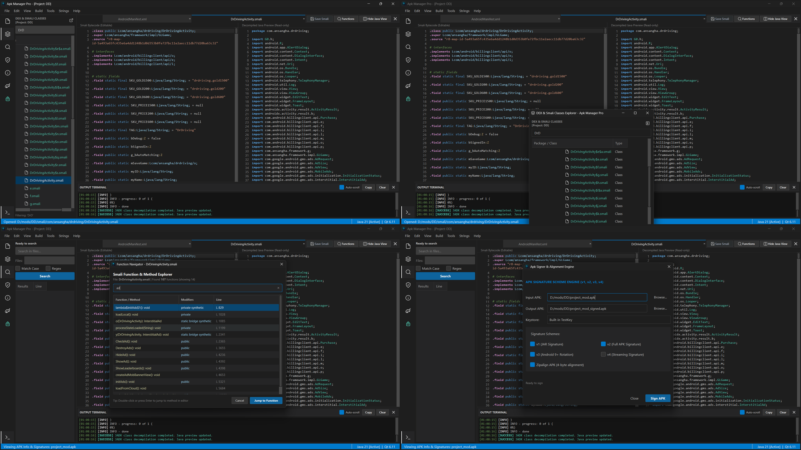

# Apk Manager Pro (v1.0.1)

A high-performance Android reverse engineering, APK modification, and signing IDE for Windows, combining the rapid workflow of MT Manager with the modern workspace ergonomics of VS Code.

**Developed by Skill Light**

---



---

## Overview

Android reverse engineering on desktop environments has historically been constrained by tools designed either strictly for read-only static analysis or heavyweight full-decompilation pipelines:
- **[JADX / JADX-GUI](https://github.com/skylot/jadx)**: A premier Dalvik decompiler with high-quality Java reconstruction and interactive control-flow graph (CFG) analysis, but designed strictly as a **read-only** static analysis tool. JADX has no editing, byte-modifying, repackaging, or APK signing capabilities.
- **[APK Studio](https://github.com/vaibhavpandeyvpz/apkstudio)**: A cross-platform IDE that wraps Apktool, `baksmali`, and Android SDK tools. While functional, it mandates a full project decompile/recompile cycle—unpacking every DEX and resource into tens of thousands of loose disk files. This incurs heavy disk I/O, consumes gigabytes of storage, and frequently fails on obfuscated, protected, or multi-DEX APKs.
- **MT Manager**: Mobile reverse engineers prefer MT Manager due to its instantaneous in-place ZIP/DEX modifications and dual-pane workflow, but using it on Windows requires running heavy Android emulators or virtualization layers.

**Apk Manager Pro (v1.0.1)** bridges this divide. Built natively in C++17 with Qt 6, it delivers an in-memory Virtual File System (VFS) for instant APK exploration and modification, combined with a synchronized dual-pane Smali/Java editor, a standalone DEX Explorer, built-in multi-scheme signing (v1/v2/v3), and a modern VS Code dark environment.

---

## Detailed Comparison: Apk Manager Pro vs. JADX vs. APK Studio

The following table provides an architectural and feature comparison between **Apk Manager Pro**, **JADX-GUI ([skylot/jadx](https://github.com/skylot/jadx))**, and **APK Studio ([vaibhavpandeyvpz/apkstudio](https://github.com/vaibhavpandeyvpz/apkstudio))**:

| Feature / Dimension | Apk Manager Pro (v1.0.1) | JADX-GUI (`skylot/jadx`) | APK Studio (`vaibhavpandeyvpz/apkstudio`) |
|---|---|---|---|
| **Core Architecture & Philosophy** | **Full Modding, Editing & Signing IDE** with hybrid in-place VFS and standalone projects | **Read-Only Static Analysis & Decompiler** | **Wrapper IDE for Full Apktool Extraction** |
| **Language & Engine** | Native **C++17 & Qt 6** (low memory, instant startup) | **Java / Kotlin** on JVM (Swing UI, high heap consumption) | **C++ & Qt** (front-end CLI wrapper) |
| **Editing & Rebuilding** | **Yes**: Direct in-place editing, Smali modifications, and automated APK rebuilding | **No**: Strictly read-only decompilation | **Yes**: Edits loose disk files, recompiles via external CLI calls |
| **APK Container Access (VFS)** | **In-memory Virtual File System (VFS)**; browse, edit, and replace files without full extraction | Reads ZIP entries for decompilation view only; no archive writeback | **No VFS**: Forces full Apktool disassembly of entire APK to disk |
| **Smali Bytecode Editing** | **Dedicated Code Editor**: Smali syntax highlighting, line numbers, register coloring, dirty-state tracking | **None** (Only provides read-only Smali dumping) | Basic plain-text editor for disassembled Smali files |
| **Code Suggestions & Autocompletion** | **Built-in deterministic autocompletion** for Smali directives, Dalvik opcodes, registers, types, and labels | N/A (Read-only viewer) | No Smali-specific intelligent autocompletion |
| **Smali ↔ Java Dual-Pane** | **Side-by-side synchronized view**: Smali on left (editable), decompiled Java on right (read-only preview) | **Java viewer only** with syntax highlighting (no split Smali editing) | **No synchronized preview** (Smali only; requires external tools for Java) |
| **Multi-File Tabbed Workspace** | **Multi-tab editor** with in-memory caching of bytecode, Java preview, cursor positions, and scroll offsets | Tabbed document interface for classes and resources | Basic MDI / Tabbed editor |
| **DEX / Class Navigation** | **Dedicated DEX Explorer**: Combined multi-DEX class tree, live search filter, and **popout floating window** | Package tree for all DEX files | Standard filesystem tree of extracted project folder |
| **DEX String Pool Inspection** | **Full String Pool Analyzer**: Lists all strings across all DEX files with one-click redirection to Smali | Text search and basic string dumping | Basic search within extracted text files |
| **Setup & Dependencies** | **100% Plug-and-Play**: Download, extract, and run. Zero external setup required | Download and run JAR / EXE | Tedious manual setup: requires manually installing and configuring paths for Android SDK, Apktool, and keystores |
| **Signing & Alignment Tooling** | **Integrated Uber Apk Signer & Zipalign**: v1/v2/v3 schemes, debug/custom keys, automatic `.idsig` cleanup | **None** | Basic signer (requires external `jarsigner`/`apksigner` setup) |
| **APK & Security Inspector** | **Comprehensive APK metadata panel**: Package info, SDK levels, components, and deep X.509 cert analysis | Reads APK certificates and manifest headers | Minimal APK info display |
| **Ad & Tracker Detection** | **Multi-threaded scanner** detecting AdMob, Unity, AppLovin, IronSource, Mintegral, Firebase, etc. | **None** | **None** |
| **Persistent Standalone Projects** | **Yes**: Create persistent projects on disk with non-destructive working environments and recent project history | Saves `.jadx` project states (mappings, comments, bookmarks) | Creates folder projects from Apktool extractions |
| **Disk & Memory Footprint** | **Zero unnecessary disk writes** in quick mod mode; low RAM footprint | High memory usage for large multi-DEX APKs due to JVM heap | High disk usage due to full asset and resource extraction |

---

## Two Distinct Workflows: VFS vs. Project Mode

Apk Manager Pro provides two dedicated workflows tailored to different reverse engineering scenarios:

```
┌────────────────────────────────────────────────────────────────────────┐
│                          Apk Manager Pro                               │
└───────────────────┬────────────────────────────────┬───────────────────┘
                    │                                │
       [Quick Open APK File (Ctrl+O)]    [Project Mode (Ctrl+Shift+N/O)]
                    │                                │
                    ▼                                ▼
       Virtual File System (VFS)          Full Decompiled Environment
  - Opens APK directly as ZIP archive   - Persistent folder on disk
  - Zero disk extraction for assets     - Decompiles Smali, res, assets
  - Files read from memory              - Persistent project.json & recents
  - Save directly updates archive file  - Recompiles via Apktool + Signer
```

### 1. Quick Open APK File (`Ctrl+O`) — Virtual File System (VFS)
- **When to use**: Quick edits, asset inspection, instant manifest checking, and in-place APK modification without disk clutter.
- **How it works**: Mounts the APK file directly in memory via an in-place Virtual File System (`QZipReader` / `QZipWriter`).
- **Zero Disk Extraction**: Internal assets, layouts, scripts, and libraries are read directly from memory into the editor without extracting files to disk.
- **In-Place Save**: Pressing `Ctrl+S` writes changes directly back into the APK archive container in-place, mirroring the rapid workflow of MT Manager.

### 2. Standalone Project Mode (`Ctrl+Shift+N` / `Ctrl+Shift+O`) — Persistent Environment
- **When to use**: Deep, multi-file modding projects, extensive Smali bytecode rewrites, resource renaming, or long-term app maintenance.
- **How it works**: Creates a standalone workspace folder on disk containing disassembled Smali bytecode, decoded XML resources, assets, and project descriptor (`apkmanager_project.json`).
- **Non-Destructive**: Project files are persistent on disk and never deleted on exit.
- **Recent Projects**: Quickly reopen existing projects from the start screen or File menu with automatic on-disk existence validation.

---

## Architectural Distinctions

### 1. In-Place Archive VFS vs. Full Project Extraction
APK Studio requires running Apktool to decompile the entire APK—extracting thousands of image assets, sound files, native libraries, and split XML manifests to disk. For modern 100MB+ games and apps, this process can take minutes and consume gigabytes of storage. Apk Manager Pro implements an MT Manager-inspired in-memory VFS, allowing you to open an APK immediately, edit targeted bytecode or manifests, and package changes without touching unrelated assets.

### 2. Dual-Pane Smali ↔ Java Workflow
While JADX produces superior Java decompilation, reverse engineers often need to modify the actual underlying Dalvik bytecode via Smali. Apk Manager Pro couples the decompilation prowess of JADX with an editable Smali buffer in a side-by-side split screen. You can read high-level Java logic while modifying precise Dalvik registers and instructions directly.

### 3. Dedicated DEX Class Explorer with Detachable Floating Window
Unlike standard file trees that mirror disk folder structures, Apk Manager Pro features a dedicated DEX Explorer that merges `classes.dex`, `classes2.dex`, `classes3.dex`, etc. into a single unified package tree. For multi-monitor workstations, the DEX Explorer can be popped out into an independent floating window, dedicating 100% of the main IDE window to code editing.

### 4. Zero-Residual Signing Pipeline
Other modding suites often leave stray `.idsig`, `.tmp`, or intermediate build artifacts cluttering your mod directories. Apk Manager Pro embeds an automated signing engine with verification, zipalign, and automatic residual cleanup.

### 5. True Plug-and-Play (Zero Configuration Hell)
Unlike **APK Studio**, which forces users through a tedious initial setup process—demanding manual installation and path configuration for the Android SDK, Build-Tools, `aapt`, `zipalign`, external `apktool.jar`, and Java keystores before it can even open an APK—**Apk Manager Pro** is **100% plug-and-play**. All required decompiler binaries, disassemblers, signers, and analyzers are bundled directly with the application. Simply download, extract, and start modding immediately with zero setup required.

---

## Core Features in v1.0.1

- **Standalone Project Environments**: Create and manage persistent modding projects with decompiled Smali, resources, manifests, and internal APK copies that persist across sessions.
- **Recent Projects on Disk**: Instant access to recently opened projects with automatic on-disk existence validation.
- **Virtual File System (VFS)**: Inspect, extract, and replace files directly inside APK archives without full decompression.
- **Smali Code Suggestions**: Non-AI, deterministic autocompletion for Dalvik opcodes (`invoke-virtual`, `const-string`, etc.), directives (`.method`, `.registers`, etc.), Android type descriptors (`Landroid/content/Context;`), registers (`v0-v15`, `p0-p7`), and dynamic in-file jump labels.
- **DEX String Pool Inspection**: View all strings across all DEX containers with quick filter and double-click Smali redirection.
- **Automatic GitHub Release Updater**: Built-in non-blocking update checker that automatically queries GitHub releases on startup, displays formatted release notes, and offers one-click downloads.
- **Popout DEX Explorer**: Toggle between docked sidebar and standalone window mode to maximize editor screen real estate.
- **Live Apktool Decompilation Modal**: Active progress dialog with real-time log streaming during project generation.
- **Integrated Multi-Scheme APK Signer**: Complete support for Android v1, v2, and v3 signature schemes with 4-byte zipalign verification.
- **Ad & Tracker Rule Engine**: Built-in multi-threaded analysis for mobile advertising and tracking frameworks.
- **Exclusive Dark Theme**: Refined VS Code-inspired dark UI palette tailored for long reverse engineering sessions.

---

## System Requirements

- **Operating System**: Windows 10 / Windows 11 (64-bit)
- **Java Runtime Environment**: Java JRE/JDK 17 or newer configured in the system `PATH` (required for Apktool and JADX background operations)

---

## Distribution & Releases

Apk Manager Pro **v1.0.1** is packaged and distributed as precompiled standalone Windows 64-bit binaries.

1. Download the release package (`ApkManagerPro-v1.0.1-win64.zip`) from the GitHub **Releases** page.
2. Extract the archive to your chosen directory.
3. Run `ApkManagerPro.exe`.

---

## Feedback & Contributions

As Apk Manager Pro is currently in **v1.0.1**, I will be deeply grateful for your feedback, feature suggestions, and bug reports. Please feel free to open an issue or share your ideas on GitHub to help make this tool even better!

---

## About Apk Manager Pro

**Apk Manager Pro** is developed by **Skill Light** as a high-performance, native Windows reverse engineering environment. It is designed to offer the rapid, non-destructive workflow popularized by MT Manager with desktop-grade VS Code ergonomics, multi-DEX navigation, on-demand JADX decompilation, and multi-scheme APK signing.

- **GitHub Repository:** [https://github.com/skill-light/Apk-Manager-Pro](https://github.com/skill-light/Apk-Manager-Pro)
- **Author & Maintainer:** Skill Light
- **Current Release:** v1.0.1 (Production)
- **Built with:** Native C++17, Qt 6.11.3 (MSVC 2022 64-bit)
- **Toolchain:** Apktool v2.10.0, JADX v1.5.0, Uber-APK-Signer v1.3.0

